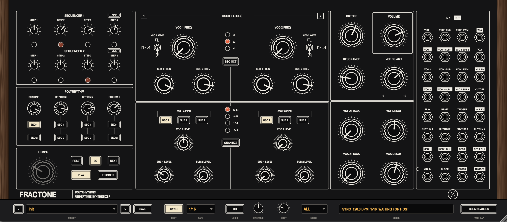

# Fractone

A polyrhythmic undertone synthesizer for any DAW that hosts VST3 (or AU on
macOS) instruments. Two oscillators each carry two subharmonic dividers
(f/1 to f/16), four rhythm generators divide one clock by 1 to 16, and two
four-step sequencers turn those integer ratios into interlocking patterns.
Everything ends in a resonant four-pole ladder filter and a VCA, with a
32-point patchbay for re-routing the signals inside the instrument.



It's a personal learning instrument: the panel follows the layout of the
hardware this style of synth comes from, so time spent on Fractone carries over.

## Download

You don't need to build Fractone yourself. Ready-made plugins for macOS,
Windows and Linux are on the [Releases page](../../releases/latest).
Download the archive for your system from the latest release:

| Archive | Contains |
|---|---|
| macOS `.zip` | `Fractone.vst3`, `Fractone.component` (Audio Unit) and `Fractone.app` (standalone); universal for Apple silicon and Intel |
| Windows `.zip` | `Fractone.vst3` and `Fractone.exe` (standalone) |
| Linux `.tar.gz` | `Fractone.vst3` and `Fractone` (standalone) |

Then install the plugin:

- **macOS**: move `Fractone.vst3` into `~/Library/Audio/Plug-Ins/VST3` and
  `Fractone.component` into `~/Library/Audio/Plug-Ins/Components`, then run:

  ```sh
  xattr -dr com.apple.quarantine ~/Library/Audio/Plug-Ins/VST3/Fractone.vst3 \
      ~/Library/Audio/Plug-Ins/Components/Fractone.component
  ```

  The builds aren't signed with an Apple developer certificate, so macOS
  quarantines them when downloaded, and the DAW refuses to load them until
  you clear that flag.
- **Windows**: copy the whole `Fractone.vst3` folder into
  `C:\Program Files\Common Files\VST3`.
- **Linux**: copy `Fractone.vst3` into `~/.vst3`.

Then rescan plug-ins in your DAW.

## Building from source

Every platform needs:

- CMake 3.22 or newer
- Git
- A C++20 compiler (see each platform below)
- An internet connection for the first configure

Every build is the same three steps: configure, build, test. The first
configure downloads JUCE 8.0.9, which includes the VST3 SDK, so it takes a few
minutes; later builds are incremental.

### macOS

Install the Xcode command line tools and CMake:

```sh
xcode-select --install
brew install cmake          # or the installer from cmake.org
```

Then build:

```sh
cd path/to/fractone
cmake -B build -DCMAKE_BUILD_TYPE=Release
cmake --build build --config Release -j
ctest --test-dir build -C Release --output-on-failure
```

The build installs `Fractone.vst3` into `~/Library/Audio/Plug-Ins/VST3` and
`Fractone.component` into `~/Library/Audio/Plug-Ins/Components`. A standalone
`Fractone.app` is in `build/Fractone_artefacts/Release/Standalone`.

- It builds for your Mac's own processor. For a universal binary, add
  `-DCMAKE_OSX_ARCHITECTURES="arm64;x86_64"` to the configure step.
- Near the end of the build you'll see lines like *"Replacing invalid
  signature with ad-hoc signature"*. They're normal: JUCE re-signs the plugin
  after adding its metadata, and an ad-hoc signature is all you need on your
  own machine.

### Windows

You need **Visual Studio 2022** (Community is fine) with the **Desktop
development with C++** workload, which includes CMake, and **Git for
Windows**.

Open **Developer PowerShell for VS 2022**, then:

```powershell
cd path\to\fractone
cmake -B build -G "Visual Studio 17 2022" -A x64
cmake --build build --config Release
ctest --test-dir build -C Release --output-on-failure
```

The plugin is built to `build\Fractone_artefacts\Release\VST3\Fractone.vst3`.
That's a folder: copy the whole folder into
`C:\Program Files\Common Files\VST3`.

To have the build copy it there for you, run the terminal as Administrator
and add `-DFRACTONE_COPY_PLUGIN=ON` to the configure step. Writing to that
folder needs administrator rights, which is why the copy is off by default on
Windows.

### Linux

Ableton Live doesn't run on Linux, but Fractone works in any VST3 host there,
such as Bitwig Studio, REAPER or Ardour.

You need GCC 11+ or Clang 14+. On Debian or Ubuntu, install the toolchain and
JUCE's dependencies:

```sh
sudo apt install build-essential cmake git pkg-config \
    libasound2-dev libfreetype-dev libfontconfig1-dev libgl1-mesa-dev \
    libx11-dev libxcomposite-dev libxcursor-dev libxext-dev \
    libxinerama-dev libxrandr-dev libxrender-dev
```

On other distributions, install the equivalent `-devel` packages. Then build:

```sh
cd path/to/fractone
cmake -B build -DCMAKE_BUILD_TYPE=Release
cmake --build build -j
ctest --test-dir build -C Release --output-on-failure
```

The build installs the plugin to `~/.vst3/Fractone.vst3`.

### Build options

| Option | Default | What it does |
|---|---|---|
| `FRACTONE_COPY_PLUGIN` | `ON` (`OFF` on Windows) | Copy the plugin into the system plug-in folders after each build |
| `FRACTONE_JUCE_DIR` | *(empty)* | Use a local JUCE 8.0.9 checkout instead of downloading one; useful offline |
| `FRACTONE_BUILD_TOOLS` | `OFF` | Also build `FractoneSnapshot`, a dev tool that renders the panel to PNG or a preset to WAV |
| `CMAKE_OSX_ARCHITECTURES` | your Mac's processor | `"arm64;x86_64"` builds a universal binary |

Pass any of these at configure time, for example
`cmake -B build -DFRACTONE_JUCE_DIR=/path/to/JUCE`.

### Continuous integration

[`.github/workflows/build.yml`](.github/workflows/build.yml) runs the same
configure, build and test steps on macOS (universal), Windows (x64) and Linux
(x64). It only runs when you start it: on GitHub, open **Actions** →
**Build** → **Run workflow**, and choose a branch or tag under **Use workflow
from**.

A run on a branch uploads the packaged plugins as artifacts, kept for 30 days.
Those are development builds; the downloads for players are on the
[Releases page](../../releases/latest).

### Making a release

1. Set the version in `CMakeLists.txt`, for example
   `project(Fractone VERSION 1.1.0 ...)`.
2. Write the release text in
   [`.github/release-notes.md`](.github/release-notes.md).
3. Commit both, then tag and push:

   ```sh
   git tag -a v1.1.0 -m "Fractone 1.1.0"
   git push origin main v1.1.0
   ```

4. On GitHub, run the **Build** workflow and pick the `v1.1.0` tag under
   **Use workflow from**.

A run on a tag builds all three platforms and creates a **draft** release
with the archives and release notes attached. Review it on the Releases page
and press **Publish**. A tag that doesn't match the version in
`CMakeLists.txt` stops the build, so the downloads can't be labelled with the
wrong version.

## Using it in Ableton Live

1. **Preferences → Plug-Ins**: turn on *Use VST3 Plug-in System Folders* (or
   *Use Audio Units*), then rescan. Fractone shows up under Plug-Ins → Taddei.
2. Drop **Fractone** on a MIDI track and press Live's play button. The Init
   patch plays a four-step sequence straight away.
3. Fractone follows Live's tempo and transport (**SYNC** on the bottom rail).
   The master clock pulses every 1/16 by default; change it with **RATE**.
   Starting Live, or jumping or looping the playhead, resets the sequencers
   and rhythm generators so every loop starts on the same downbeat.

**MIDI clips** play it like the hardware's MIDI input. Notes transpose both
oscillators relative to MIDI note 60 (Live calls it C3; the hardware manual
calls it C4) and gate the envelopes, last note wins. A clip can transpose the
running sequence, or play Fractone as a monosynth with the sequencers off.
The mapped MIDI CCs are listed below.

Everything on the panel is a host parameter, so you can map knobs with Live's
MIDI Map mode, automate them, or put them on a Push.

## The panel

The panel is read top-left to bottom-right, the same way the signal flows: the
**tempo** drives the **rhythm generators**, which advance the **sequencers**,
which play the **oscillators**. The **mixer** feeds the **filter** and **VCA**,
which the **envelopes** shape.

Hover over any control for a description. Drag knobs up and down, and
double-click a knob to reset it.

### Sequencers
Two 4-step sequencers. Sequencer 1 belongs to VCO 1 and Sequencer 2 to VCO 2.
A step knob at centre changes nothing. Turning it clockwise raises the pitch
and counter-clockwise lowers it, within the **SEQ OCT** range. The LED shows
the current step. A sequencer only moves when at least one rhythm generator is
assigned to it.

**DICE** (an addition that isn't on the hardware) writes a new phrase from
step 1. Step 1 stays where you set it, and steps 2-4 each land a consonant
interval above or below it: a 3rd, 4th, 5th, 6th, unison or octave, never a
2nd, 7th or tritone. Rolls stay within the SEQ OCT range and follow
QUANTIZE:

- **8-ET and 8-JI**: every step stays in the scale.
- **12-ET and 12-JI**: each roll is either major-flavoured or minor-flavoured,
  so its thirds and sixths don't clash.

Smaller moves are more likely than big leaps, and no note plays three times
in a row. Click again to re-roll; your host's undo brings back the previous
steps. DICE works best with OSC assigned. A sequencer assigned only to SUB 1
or SUB 2 moves divisors rather than pitch, so its rolls won't sound like the
same intervals.

Both buttons are also host parameters, **Dice Seq 1** and **Dice Seq 2**, and
each roll happens when the parameter switches on. To trigger them from a
controller in Live:

1. Click the device's **Configure** button.
2. Click a DICE button so the parameter appears in the device.
3. Use MIDI Map mode (⌘M) and press a pad or button.

Map it as a momentary button: in a toggle mapping only every other press
rolls. The same parameters work from Push, rack Macros and automation lanes;
draw a short pulse every few bars and the phrase re-rolls as the song plays.
Loading a preset or reopening a set never rolls.

### Polyrhythm
Each **RHYTHM** knob divides the clock by an integer: **1 fully clockwise, 16
fully counter-clockwise**, as on the hardware. Its **SEQ 1** and **SEQ 2**
buttons choose which sequencers it advances. The buttons flash on every pulse
their rhythm produces. Assign two rhythms to one sequencer and you have a
polyrhythm. Because all four count from the same clock, the pattern always
comes back around to a shared downbeat. **LOGIC** on the rail switches between
OR (advance on any pulse) and XOR (coinciding pulses cancel).

### Tempo and transport
- **TEMPO**: the free-running clock, 20 to 3000 BPM with one pulse per beat.
  It's dimmed while SYNC follows the host.
- **PLAY**: run or stop the sequencers. With SYNC on, they run while Live
  plays and PLAY is lit.
- **RESET**: back to step 1, with the rhythm generators re-aligned. Hold it to
  hold step 1 while the envelopes keep firing; press **NEXT** while holding to
  move on.
- **NEXT**: advance one step. With playback stopped this is how you tune each
  step.
- **EG**: click to toggle whether sequencer steps fire the envelopes. **Hold
  until it blinks** to hold both envelopes wide open, which is ideal for
  tuning.
- **TRIGGER**: fire the envelopes. With EG off it acts as a gate while you hold
  it.

### Oscillators
- **VCO FREQ**: four octaves, from middle C up to the top C.
- **SUB 1 / SUB 2 FREQ**: each is the oscillator's own pitch divided by 1
  (fully clockwise, unison) to 16. They're phase-locked dividers, so they
  stay locked to the oscillator.
- **WAVE** switch. Up gives a square on all three. Down gives a saw on all
  three. The middle is the special one: the oscillator plays a pulse whose
  width is swept by SUB 1's sawtooth, while the subs play saws. You can hear
  SUB 1 in the oscillator's timbre even with its level down.
- **SEQ OCT**: the step knobs' range, ±1, ±2 or ±5 octaves. **Hold until the
  LED blinks** to keep the SEQ output jacks at ±5 regardless.
- **QUANTIZE**: Off, 12-ET, 8-ET, 12-JI or 8-JI, applied to the FREQ knobs and
  the steps. In just intonation, chords built from the subs stop beating.
  **Hold until the LED blinks** to send unquantized CV from the SEQ jacks.

### Mixer
- **SEQ ASSIGN**: which part of each voice its sequencer moves. **OSC** moves
  the oscillator's pitch, and its subs follow. **SUB 1** and **SUB 2** change
  that sub's divisor instead, with clockwise steps giving a smaller divisor
  and a higher pitch. Any combination works.
- **LEVEL** knobs for all six sources. Push several of them high and the
  mixer saturates warmly, like the hardware.

### Filter, VCA and envelopes
- **CUTOFF**: 20 Hz to 20 kHz.
- **RESONANCE**: at maximum the filter rings on its own (the *Ladder Kick*
  preset uses it as a drum).
- **VCF EG AMT**: bipolar, with no effect at centre.
- **VOLUME**: the level the VCA envelope opens to.
- **ATTACK**: 1 ms to 10 s. **DECAY**: 5 ms to 10 s. As on the hardware, an
  envelope ignores new triggers until its attack has finished.

### Patchbay
There are 17 inputs (plain labels) and 15 outputs (white labels). Drag from an
output to an input to patch a cable; dragging from an input also works.

- **Move or pull a cable**: grab its plugged input end.
- **Unplug**: right-click a jack. On an output, this removes all its cables.
- Each input takes one cable. An output can feed as many inputs as you like.
- **CLEAR CABLES** on the rail unplugs everything.

Patching replaces the normal internal connection where the hardware does. For
example, a cable into **VCO 2** breaks the normal from VCO 1's input, and one
into **VCO 1 PWM** replaces the SUB 1 saw in the middle WAVE position. Signals
use the hardware's voltage ranges: 1 V/oct pitch, envelopes from 0 to +8 V,
clocks as pulses. **MIDI IN** is drawn for familiarity; it's Live's MIDI and
isn't patchable. Its LED blinks on incoming notes and CCs.

### Bottom rail
These controls stand in for things the hardware does with hidden gestures or
external gear:

| Control | What it does |
|---|---|
| **< Preset >**, **SAVE** | Browse and save presets (see below) |
| **SYNC** / **RATE** | Follow Live's tempo and transport, and the clock pulse length (1/1 to 1/64, plus triplets) |
| **LOGIC** | OR / XOR for combining rhythms |
| **FINE TUNE** | ±50 cents (the hardware does this by holding OSC 1 + OSC 2) |
| **DRIFT** | Slow analog-style pitch wander |
| **MIDI CH** | Channel for notes and CCs, or All |
| Status | Clock source, tempo and transport state |

## Presets

Click the preset name to browse. Factory presets come first, then yours.

| Factory preset | Idea |
|---|---|
| Init | A first sequence: Sequencer 1 plays VCO 1 from Rhythm 1 |
| Tidepool Chords | Clock-retriggered chords with Sequencer 1 also sweeping the cutoff |
| Soft Ratios | Mellow two-voice harmony; Sequencer 1's clock fires the envelopes |
| Stumble Down | Cross-patched sequencers, and envelopes that bend the rhythms |
| Ground State | Full mixer into a slow, deep filter swell |
| Many Hands | Both sequencers steer VCO 2 |
| Ladder Kick | No oscillators: the self-oscillating filter is a drum machine |
| Spiral Stair | Fifths and thirds below, with the filter envelope bending Rhythm 1 |
| Night Clusters | Three rhythms percolating one sequencer; ride the mixer |
| Odd Rock | Slow chord changes over a clock "drum" (CLOCK into VCA) |
| Cloud Walk | Fade voices in one by one; slow attacks |

Step pitches are suggestions, so tune them to taste. Loading a preset never
changes SYNC, MIDI CH or FINE TUNE; those belong to the track.

### Your own presets
- **SAVE** overwrites the user preset you have loaded. On a factory preset it
  asks for a name instead.
- **Save As...** in the preset menu always asks for a name. Saving under an
  existing name replaces that preset.
- **Delete** in the menu moves the current user preset to the Trash.
- **Show Presets Folder** opens the folder in Finder.

An asterisk after the name means you've changed something since loading.

User presets are saved as `.fractone` files in
`~/Library/Application Support/Fractone/Presets`. They hold every knob, switch
and patch cable, can be copied between machines, and show up in every Live
set. Live's own device presets (the save icon in the device title bar) work
too, as does saving the Live set.

## MIDI CC map

These are the CCs from the hardware's MIDI implementation:

| CC | Parameter | Behaviour |
|---|---|---|
| 4 / 36 (MSB/LSB) | VCO 1 frequency | ±2.5 octaves added to the knob |
| 12 / 44 | VCO 2 frequency | ±2.5 octaves added to the knob |
| 103, 104 | VCO 1 SUB 1, SUB 2 divisor | 0-7 = /16 ... 120-127 = /1; moving the knob takes over again |
| 105, 106 | VCO 2 SUB 1, SUB 2 divisor | as above |
| 23 / 55 | VCF attack | replaces the knob until it moves |
| 24 / 56 | VCF decay | " |
| 28 / 60 | VCA attack | " |
| 29 / 61 | VCA decay | " |
| 113 | Rhythm logic | 0-63 OR, 64-127 XOR |
| 120, 123 | All sound / notes off | |

## Development

- `Source/Engine`: the whole instrument as plain C++, with no JUCE. It runs at
  2× the host rate with band-limited oscillators and is decimated on output.
- `Tests/EngineTests.cpp`: behaviour tests against the hardware manual
  (divider pitches, rhythm division, OR/XOR, envelope rules, transport,
  patching, MIDI, quantize).
- `Tools/Snapshot.cpp` (with `-DFRACTONE_BUILD_TOOLS=ON`):
  - `FractoneSnapshot panel.png 3` renders the panel with preset 3 loaded.
  - `FractoneSnapshot sound.wav 3 8` renders 8 s of preset 3 at 120 BPM.
  - `FractoneSnapshot --preset-test` checks user-preset save/load and session
    restore.

## License

Copyright (C) 2026 Taddei

Fractone is free software: you can redistribute it and/or modify it under the
terms of the GNU Affero General Public License as published by the Free
Software Foundation, either version 3 of the License, or (at your option) any
later version. It is distributed in the hope that it will be useful, but
without any warranty; see [LICENSE](LICENSE) for the full text.

Fractone is built on [JUCE](https://juce.com), used under its AGPLv3
open-source licence, together with the VST3 SDK that JUCE includes.
